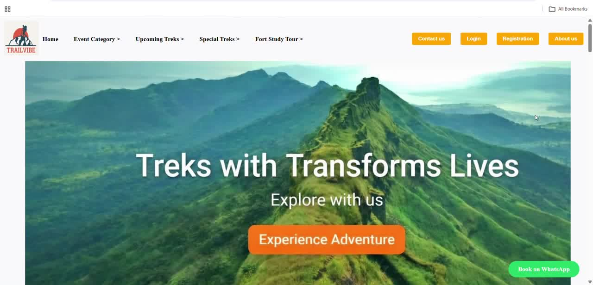
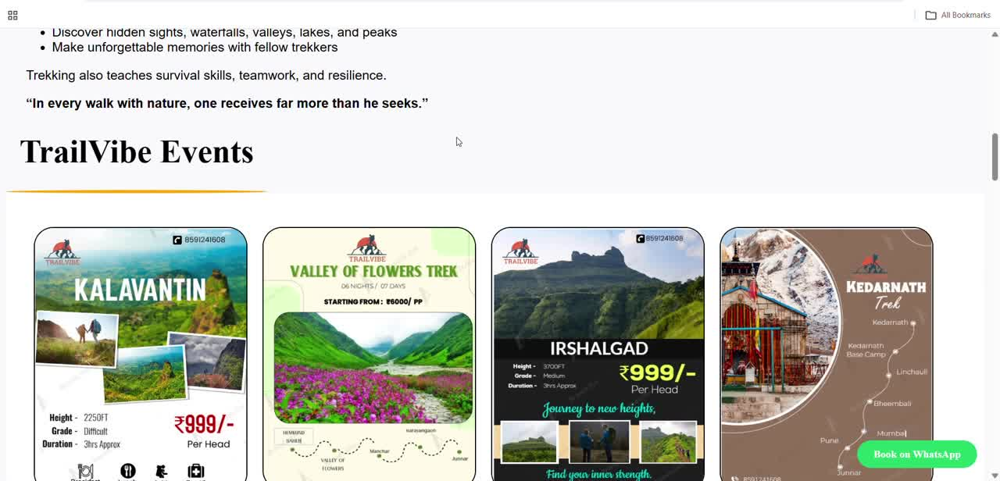

# 🏔️ TrailVibe – Trekking Booking Website

**TrailVibe** is a website for people who love trekking. You can see upcoming treks and forts, create an account, log in, and book your place on a trek. The trek organizer (admin) can add and remove treks from a private dashboard.

> *"Treks that transform lives."*



---

## 🎬 Live Demo

Watch the project working (no setup needed):

| Demo | What you will see |
|------|-------------------|
| ▶️ [**Website Demo**](demo/website-demo.mp4) | Home page, events, About Us, registration, login and booking forms |
| ▶️ [**Database Demo**](demo/database-demo.mp4) | How the information is stored in the database (phpMyAdmin) |



*(Click a link above and the video opens in GitHub's video player.)*

---

## ✨ Features

### 👤 For Trekkers (Normal Users)
- **Home page** with a big banner, menu, and easy navigation.
- **Create an account** (Registration) – name, email, password, phone number, date of birth and nationality.
- **Safe login** – passwords are stored in a secret, scrambled form, so nobody can read them.
- **Weekend Treks** – upcoming treks are shown as cards with a photo, place, date and price (₹). These cards come directly from the database, so they update automatically.
- **TrailVibe Events** – special trek events with posters and a **Book** button.
- **Easy booking** – fill in your name, mobile number and village / address, then confirm. Your booking is saved.
- **Book on WhatsApp** – a button that opens WhatsApp so you can chat with the organizers directly.
- **Trek by Categories** and **Beyond the Trail** sections to explore different kinds of treks.
- **About Trekking and Benefits of Trekking** – simple information about why trekking is good for body and mind.
- **About Us page** – our mission, vision, team and contact details.

### 🛠️ For the Admin (Trek Organizer)
- **Separate admin login** – the admin is sent to a private dashboard after logging in.
- **Add a new trek** – enter trek name, date, fort / place, location, difficulty (Easy / Medium / Hard), pickup and drop location, number of days, meals included (breakfast, lunch, dinner), price, and upload a photo.
- **See all treks in one table** – photo, name, date, location, difficulty, days, meals and price.
- **Delete a trek** with one click.
- **Protected page** – only a logged-in admin can open the dashboard. Everyone else is sent back to the login page.
- **Logout** button.

---

## 🧰 Built With

| Part | Technology | In simple words |
|------|-----------|-----------------|
| Pages and layout | **HTML** | The structure of every page |
| Colours and design | **CSS** | Makes the pages look good |
| Website logic | **PHP** | Handles login, registration and bookings |
| Data storage | **MySQL** | Stores users, treks and bookings |
| Local server | **XAMPP** | Lets you run the website on your own computer |

---

## 🗂️ What Is Inside This Folder

| File | What it does |
|------|--------------|
| `HY.php` | The **home page** (main page of the website) |
| `Registrationpage.html` and `registration.php` | Sign-up form and the code that saves the new user |
| `login.php` and `logout.php` | Log in and log out |
| `admin_dashboard.php` | The admin's private dashboard |
| `admin_add_tre.php` and `admin_delete_trek.php` | Add or delete a trek |
| `Booking.php` and `save_booking.php` | Trek booking form and saving the booking |
| `event_booking.php` and `save_event_booking.php` | Event booking form and saving the booking |
| `aboutus.html` and `aboutus.css` | About Us page |
| `db.php` | Connects the website to the database |
| `uploads/` and image files | Photos used on the website |
| `demo/` | Demo videos and screenshots |

---

## 🚀 How to Run This Project on Your Computer

You do **not** need to be a programmer. Just follow these steps.

### Step 1 – Install XAMPP
Download and install **XAMPP** from [apachefriends.org](https://www.apachefriends.org).

### Step 2 – Copy the project
Download this project (green **Code** button → **Download ZIP**), unzip it, and put the folder named **`trailvibe`** inside:

```
C:\xampp\htdocs\
```

### Step 3 – Start the servers
Open the **XAMPP Control Panel** and click **Start** next to **Apache** and **MySQL**.

### Step 4 – Create the database
1. Open your browser and go to `http://localhost/phpmyadmin`
2. Click **New** and create a database named **`trailvibe`**
3. Click the **Import** tab, choose the file `database/trailvibe.sql` from this project, and click **Go**

### Step 5 – Check the database port
Open the file `db.php`. The line `$port = 3307;` must match the port MySQL uses on your computer. In many XAMPP installations it is **3306**. If the website says *"Database connection failed"*, change this number.

### Step 6 – Open the website
Go to:

```
http://localhost/trailvibe/HY.php
```

🎉 That is it! The TrailVibe home page should open.

### Creating an admin account
Register a normal user on the website, then open **phpMyAdmin → trailvibe → users**, edit that user and change the **role** from `user` to `admin`. Now log in with that email to see the admin dashboard.

---

## 🗄️ Database Tables

The database is called **`trailvibe`** and has 4 tables:

| Table | What it stores |
|-------|----------------|
| `users` | Registered people (name, email, scrambled password, phone, date of birth, nationality, role) |
| `weekend_treks` | Treks added by the admin (name, date, place, difficulty, meals, price, photo) |
| `booking` | Trek bookings made by visitors |
| `eventbooking` | Event bookings made by visitors |

---

## 🔮 Future Ideas

- Online payment for bookings
- Booking confirmation by SMS or email
- Search and filter treks by place or difficulty
- Admin page to see all bookings
- Photo gallery and trekker reviews

---

## 👩‍💻 Made By

**Ankita Gabhale** and team – *TrailVibe Trekking Community*

📧 trailvibe@gmail.com

---

*Made with ❤️ for people who love mountains, forts and fresh air.*


